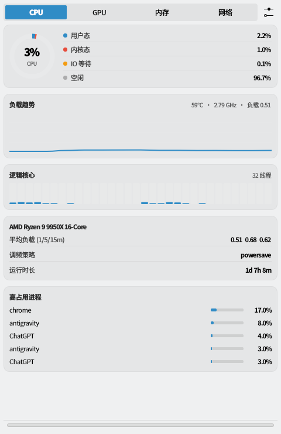
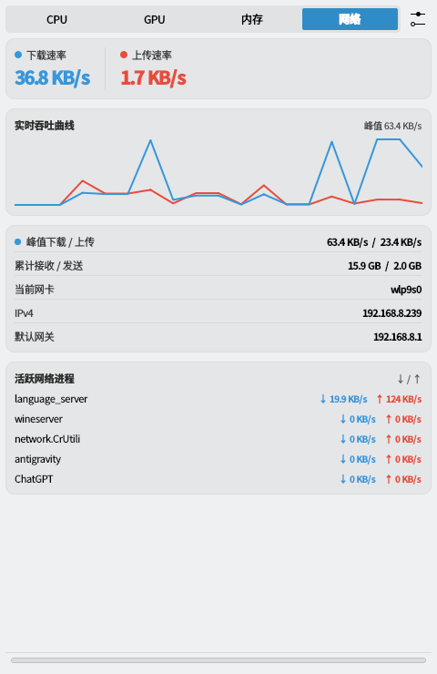
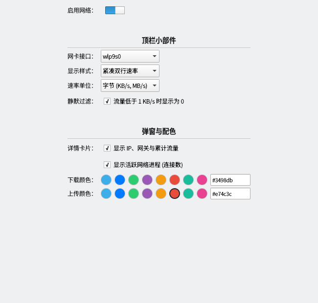

# Plasma Stats (`org.local.plasmastats`)

一款对标 macOS **Stats** 的 **KDE Plasma 6** 模块化系统监控面板微件（Plasmoid），专为 KDE Plasma 6（含 Bazzite / Fedora Kinoite 等不可变系统）设计，纯 QML + JavaScript 实现，无需编译、无需 root 权限即可安装到用户目录。

---

## 界面预览

### 顶栏常驻监控条


### 详情弹窗与设置界面
| CPU 详情仪表盘 | 网络详情与活跃进程 | 中文设置界面 |
| :---: | :---: | :---: |
|  |  |  |

---

## 一、功能特性

### 1. 四大核心监控模块
- **CPU**：总占用率、多核独立柱状图 / 迷你折线图 / 纯文字、温度（°C/°F）、频率、User/System/IOWait 拆分、系统负载、Top N 高占用进程。
- **GPU**：自动/指定显卡选择（支持多显卡如双 AMD GPU `gpu0` / `gpu1`）、占用率曲线/柱状图、显存（VRAM）用量、核心温度、功耗、频率。
- **RAM（内存）**：环形/饼图、柱状图、纯文字（百分比或 GB）、已用/缓存/可用分布、Swap 占用条、Top N 内存占用进程。
- **Network（网络）**：自动/指定网卡接口、双行紧凑上下行速率 / 双折线图 / 箭头模式、`Bytes (KB/s, MB/s)` 与 `Bits (Kbps, Mbps)` 单位切换、低流量噪点过滤、峰值与累计流量、IPv4 地址显示。

### 2. 对标 macOS Stats 的 5 页设置体系
右键微件 -> **配置 Plasma Stats...**（或点击弹窗右上角齿轮图标）：
1. **General（全局）**：模块启用顺序调整（上移/下移）、刷新频率（0.5s / 1s / 2s / 3s / 5s）、配色方案（跟随系统强调色 / 单色 / 按负载动态变色 / 自定义）、温度单位（°C / °F）、模块间距、历史曲线点数、等宽数字防抖动。
2. **CPU**：开关、面板样式（柱状图 / 折线图 / 纯文字）、分核柱状图开关、温度/频率显示、Top 进程数量（0/3/5/10）、自定义颜色。
3. **GPU**：开关、目标显卡（Auto / All / gpu0 / gpu1）、面板样式（折线图 / 柱状图 / 纯文字）、显存/温度显示、自定义颜色。
4. **RAM**：开关、面板样式（环形图 / 柱状图 / 纯文字）、显示格式（% vs GB）、Swap 显示、自定义颜色。
5. **Network**：开关、网卡选择、面板样式（紧凑双行 / 折线图 / 箭头）、单位（Bytes vs Bits）、低流量噪点阈值、上下行自定义颜色。

---

## 二、交付物说明

运行 `./scripts/build-package.sh` 后，会在 `dist/` 目录生成以下安装包：
- `dist/org.local.plasmastats.plasmoid`（及带版本号的 `dist/org.local.plasmastats-1.0.0.plasmoid`）：标准 KDE Plasma 6 微件安装包（ZIP 格式），可直接发给其他机器安装。
- `dist/plasma-stats-1.0.0.tar.gz`：包含完整源码、安装/卸载脚本、`README.md` 与 `.plasmoid` 安装包的完整交付压缩包。

---

## 三、安装方法（实机操作）

> **说明**：所有安装均在当前用户目录 `~/.local/share/plasma/plasmoids/` 下完成，**不需要 `sudo` / `rpm-ostree` 权限**，系统升级也不会丢失。

### 方式 A：使用安装脚本（推荐）
```bash
cd plasma-stats
chmod +x scripts/*.sh
./scripts/install.sh
```

### 方式 B：直接使用 `kpackagetool6` 安装 `.plasmoid` 包
```bash
# 首次安装
kpackagetool6 -t Plasma/Applet -i dist/org.local.plasmastats.plasmoid

# 后续升级覆盖
kpackagetool6 -t Plasma/Applet -u dist/org.local.plasmastats.plasmoid
```

### 方式 C：图形界面安装
1. 右键桌面或面板 -> **进入编辑模式** -> **添加或管理微件**。
2. 点击右上角 **获取新微件** -> **从本地文件安装微件...**。
3. 选择 `dist/org.local.plasmastats.plasmoid` 完成安装。

### 添加到面板
1. 右键顶部/底部面板 -> **进入编辑模式** -> **添加或管理微件**。
2. 搜索 **`Plasma Stats`**，拖入面板即可。

---

## 四、实机验证清单

建议按以下步骤在真实 KDE Plasma 6 桌面环境中逐项验证：

1. **传感器连通性检查**
   ```bash
   ./scripts/verify-sensors.sh
   ```
   确认 `cpu/all/usage`、`gpu/`、`memory/`、`network/` 均能正常列出并读出数值。

2. **独立窗口快速预览（无需重启桌面）**
   ```bash
   plasmawindowed org.local.plasmastats
   ```
   检查主界面、Tab 切换与设置窗口是否无报错正常渲染。

3. **面板常驻态检查**
   - 数字更新时是否无明显左右抖动（等宽数字 `tnum`）。
   - 点击 CPU / GPU / RAM / Network 各自区域，是否能直接打开弹窗并跳转到对应 Tab。
   - 修改面板样式（如 CPU 柱状图 <-> 折线图、RAM 环形图 <-> 柱状图、Network 折线图 <-> 双行速率）是否实时生效。

4. **弹窗与设置验证**
   - CPU / RAM Tab 下是否能正确显示 Top 5 进程与负载均值。
   - 多显卡机器在 GPU 设置中切换 `Auto` / `gpu0` / `gpu1` 是否正确切换数据源。
   - 在 General 设置中调整模块顺序（上移/下移）后，面板与弹窗 Tab 顺序是否同步更新。

---

## 五、卸载与故障排查

- **卸载微件**：
  ```bash
  ./scripts/uninstall.sh
  # 或
  kpackagetool6 -t Plasma/Applet -r org.local.plasmastats
  ```
- **升级后面板未刷新**：
  ```bash
  systemctl --user restart plasma-plasmashell.service
  ```
- **查看 QML 运行日志**（如有异常）：
  ```bash
  journalctl --user -u plasma-plasmashell.service -f | grep -iE "plasmastats|qml|sensors"
  ```
